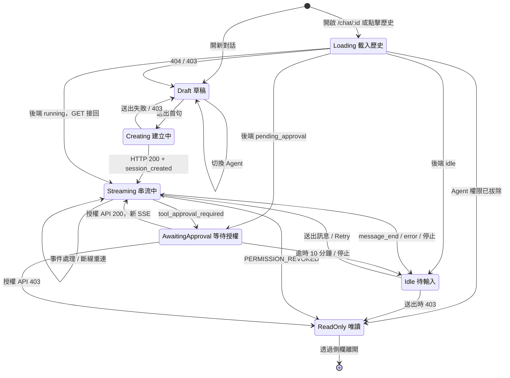
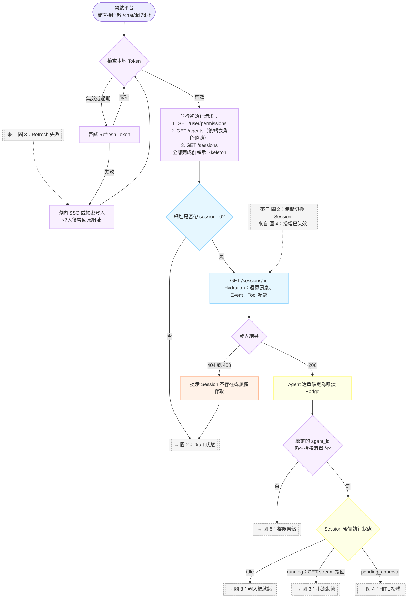
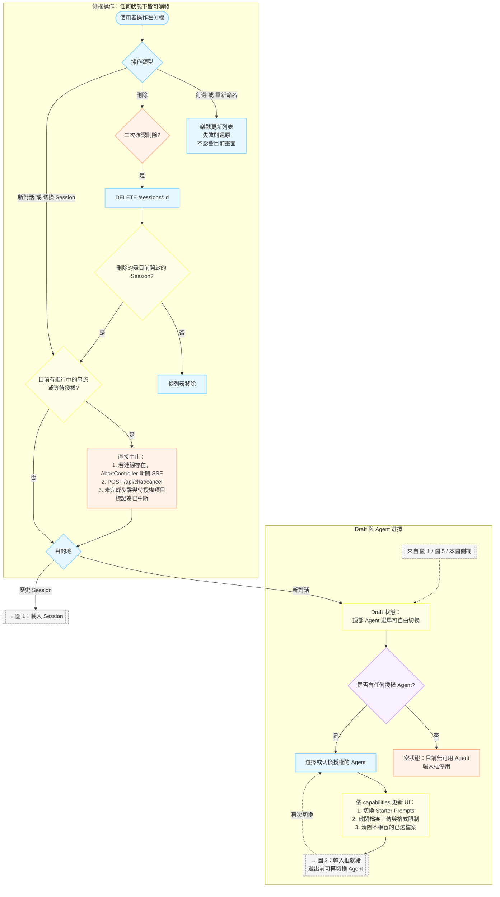
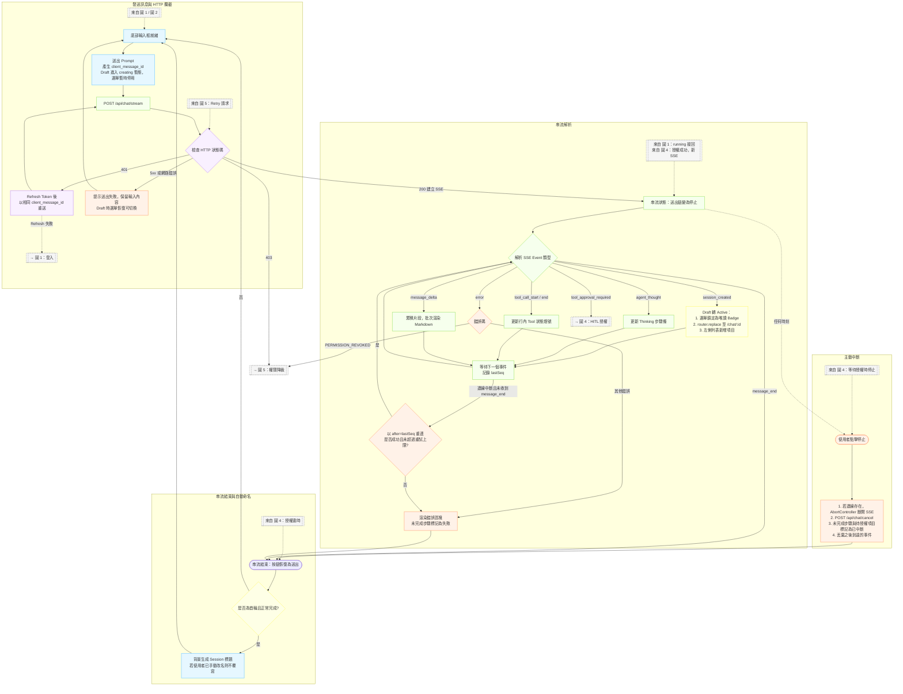
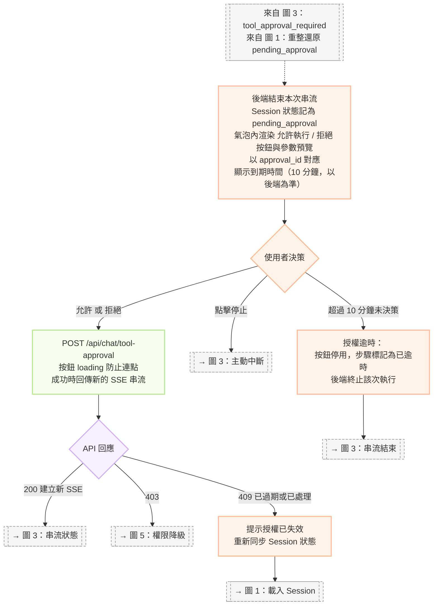

# Agentic Platform 前端流程圖（拆分版）
虛線框的雙邊節點 `[[ ]]` 代表跨圖連結：「→ 圖 N」為出口，「來自 圖 N」為入口。

## 圖 0：Session 狀態機總覽

## 圖 1：登入、初始化與 Session 載入

## 圖 2：Draft 狀態與側欄操作

## 圖 3：送出訊息、串流解析與結束

## 圖 4：人工介入授權 HITL

## 圖 5：權限降級與可觀測性

```mermaid
flowchart TD
    classDef auth fill:#f9f0ff,stroke:#d3adf7,stroke-width:2px;
    classDef ui fill:#e6f7ff,stroke:#91d5ff,stroke-width:2px;
    classDef state fill:#feffe6,stroke:#fffb8f,stroke-width:2px;
    classDef stream fill:#f6ffed,stroke:#b7eb8f,stroke-width:2px;
    classDef warn fill:#fff2e8,stroke:#ffbb96,stroke-width:2px;
    classDef dev fill:#fffbe6,stroke:#ffe58f,stroke-width:2px;
    classDef ref fill:#f5f5f5,stroke:#8c8c8c,stroke-width:1px,stroke-dasharray:4 3;

    subgraph SG_Revoke["權限異動與唯讀降級"]
        InRevoke[["來自 圖 1：Agent 權限已拔除<br/>來自 圖 3：HTTP 403 / PERMISSION_REVOKED<br/>來自 圖 4：授權 API 403"]]:::ref -.-> ToastRevoke
        ToastRevoke["彈出權限變更提示"]:::warn
        ToastRevoke --> HasSessionId{"是否已取得 session_id?"}:::state
        HasSessionId -->|否，仍為 Draft| ReloadAgents["重新取得 Agent 清單<br/>保留輸入內容"]:::warn
        ReloadAgents --> ToDraft[["→ 圖 2：Draft 狀態"]]:::ref
        HasSessionId -->|是| ReadOnlyUI["唯讀模式：<br/>可瀏覽對話與展開舊 Event<br/>鎖定輸入框、HITL 按鈕與 Retry"]:::warn
        ReadOnlyUI -.->|離開需透過側欄| ToNav[["→ 圖 2：側欄操作"]]:::ref
    end

    subgraph SG_Obs["可觀測性：依角色決定渲染內容"]
        ObsEntry(["點擊任一 Event 或 Tool 節點<br/>串流中或歷史紀錄皆可"]):::ui
        ObsEntry --> RoleBranch{"使用者角色"}:::auth
        RoleBranch -->|Standard| BasicObserve["展開行內摺疊匣<br/>僅工具名稱與狀態燈號<br/>後端不下發 Raw 資料"]:::ui
        RoleBranch -->|Developer| DevObserve["滑出 Trace Inspector<br/>動態載入元件<br/>按需 GET trace 詳細資料"]:::dev
        DevObserve --> DevActions["Raw JSON / Waterfall / 耗時 / Token 數<br/>複製 Trace ID / 匯出 Session Log"]:::dev
        DevActions -->|點擊 Retry| RetryCheck{"Session 可寫入<br/>且未在串流中?"}:::auth
        RetryCheck -->|否| RetryDisabled["Retry 按鈕停用並顯示原因"]:::dev
        RetryCheck -->|是| RetryCall["POST /api/chat/retry<br/>帶 from_node_id"]:::dev
        RetryCall --> ToHTTP[["→ 圖 3：檢查 HTTP 狀態碼"]]:::ref
    end
```

